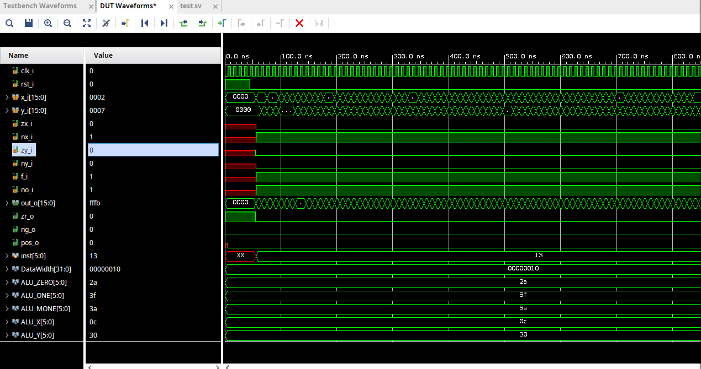

# alu-16bit-sv-verification

A 16-bit ALU in SystemVerilog verified with a layered, UVM-inspired testbench built on a **virtual interface with a clocking block**. The whole compile / elaborate / simulate flow runs from a Linux terminal through a **Makefile and the Vivado simulator (xvlog / xelab / xsim)**, without opening the Vivado GUI.

This was the final project of a hardware verification course. The design was also deployed on a Terasic DE2-115 (Intel Cyclone IV E, EP4CE115F29C7) and analyzed with static timing analysis in Quartus Prime. The FPGA wrapper and the SDC file are **not included** in this repository; the FPGA results and their context are documented in the project report in [`docs/`](docs/FinalProject_UVMVerification_ValleAdrian.pdf).

> The focus of this repository is the **verification environment**.



## Highlights

- 16-bit ALU with six control bits and 18 operations, decoded with a single `unique case`, plus registered zero / negative / positive status flags.
- DUT, stimulus and top module are separated: the `alu` is never modified for verification, and the `test` module talks to it only through the virtual interface.
- Clocking block (`cb`) for race-free driving and sampling of the DUT signals.
- Randomized operands, with reset, stimulus and monitor tasks running concurrently (`fork ... join_any / join_none`).
- Terminal-driven flow with Makefile targets (`compile`, `elaborate`, `sim`), simulation seed control and code-coverage collection enabled by default.

## Testbench architecture

```
              ┌───────────────────────── tb (top) ─────────────────────────┐
              │  clock generation (100 MHz)                                │
              │                                                            │
              │   ┌──────────┐      ┌───────────────┐      ┌───────────┐   │
              │   │   test   │◄────►│    vif_if     │◄────►│    alu    │   │
              │   │ (stimulus│  cb  │ (virtual      │ ports│   (DUT)   │   │
              │   │ + monitor│      │  interface +  │      │           │   │
              │   │  tasks)  │      │ clocking blk) │      │           │   │
              │   └──────────┘      └───────────────┘      └───────────┘   │
              └────────────────────────────────────────────────────────────┘
```

| File | Role |
|------|------|
| `alu.sv` | Design under test: ALU decoder and flag registers |
| `vif.sv` | `vif_if` interface bundling every DUT port, with the clocking block `cb` |
| `test.sv` | `test` module: `reset()`, `send_data_port()` and `monitor_output()` tasks, all driving and sampling through `vif.cb` |
| `tb.sv` | Top module: clock generation and instantiation of the interface, the DUT and the test |

In the clocking block, DUT inputs are clocking-block outputs (driven with `vif.cb.signal <= value`) and DUT outputs are clocking-block inputs (sampled through `vif.cb`), both with a 1 ns skew.

The driver and monitor roles are implemented as tasks inside the `test` module rather than as UVM classes, so this is a UVM-*inspired* layered environment and does not use the UVM class library.

## ALU operations

The ALU follows the classic six-control-bit architecture: each operand can be zeroed (`zx`, `zy`) and negated (`nx`, `ny`), the pair is combined with addition or bitwise AND (`f`), and the result can be negated (`no`). The control word is `{zx, nx, zy, ny, f, no}`.

| Control | Operation | Result | | Control | Operation | Result |
|---------|-----------|--------|-|---------|-----------|--------|
| `101010` | ZERO | 0 | | `110111` | YP1 | y + 1 |
| `111111` | ONE | 1 | | `001110` | XM1 | x − 1 |
| `111010` | MONE | −1 | | `110010` | YM1 | y − 1 |
| `001100` | X | x | | `000010` | ADD | x + y |
| `110000` | Y | y | | `010011` | SUBXY | x − y |
| `001101` | NOTX | ~x | | `000111` | SUBYX | y − x |
| `110001` | NOTY | ~y | | `000000` | AND | x & y |
| `001111` | NEGX | −x | | `010101` | OR | x \| y |
| `110011` | NEGY | −y | | `011111` | XP1 | x + 1 |

Status flags (`zr_o`, `ng_o`, `pos_o`) are registered on the clock edge.

## Repository layout

```
verification/
  Makefile.xilinx   Vivado simulator flow
  rtl/alu.sv        DUT
  sv/vif.sv         Virtual interface with clocking block
  test/test.sv      Stimulus and monitor tasks
  tb/tb.sv          Top module
scripts/vivado/
  run.tcl           xsim batch script used by the Makefile
docs/
  FinalProject_UVMVerification_ValleAdrian.pdf   Project report (IEEE format)
  waveform_xsim.png
  fpga_sel00_x.jpg, fpga_sel01_y.jpg, fpga_sel10_flags.jpg
```

## Running the simulation

Useful variables:

| Variable | Default | Description |
|----------|---------|-------------|
| `SEED` | `1` | Random seed (integer > 0) |
| `GUI_MODE` | `false` | `true` opens the xsim GUI |
| `CODE_COV` | `true` | Collects code coverage (statement, branch, condition, toggle) with `xelab -cc_type sbct` |

## FPGA deployment and timing (documented in the report)

The same ALU was wrapped for the DE2-115 using the board switches, keys and LEDs, and its timing was analyzed in Quartus Prime against an SDC constrained to the board's 50 MHz clock (20 ns period). The wrapper (`alu_top`) and the SDC file are not part of this repository; the design, constraints and hardware photos are described in the report in `docs/`.

Worst setup slack reported in the project report (50 MHz, three PVT corners):

| Corner | Slow 1200 mV 85 °C | Slow 1200 mV 0 °C | Fast 1200 mV 0 °C |
|--------|--------------------|-------------------|-------------------|
| Setup slack (ns) | 1.096 | 2.697 | 9.062 |

## Verification status

| Item | Status |
|------|--------|
| Layered testbench with virtual interface and clocking block | Done |
| Randomized operands, monitor logging | Done |
| Terminal-driven Vivado flow with seed control | Done |
| Code coverage collection | Enabled in the Makefile |
| Hardware check on DE2-115 and STA at 50 MHz | Done (see report) |
| Self-checking scoreboard or reference model | Not implemented yet |
| SystemVerilog assertions and functional coverage | Not implemented yet |

## Tools

SystemVerilog · Vivado Simulator (xvlog, xelab, xsim) · GNU Make · Linux · Quartus Prime · Terasic DE2-115 (Cyclone IV E EP4CE115F29C7)

## Author

Adrian Valle · Embedded Computer Systems Engineering, Universidad Politécnica de Yucatán · [LinkedIn](https://www.linkedin.com/in/adrianvalle-388920389)
